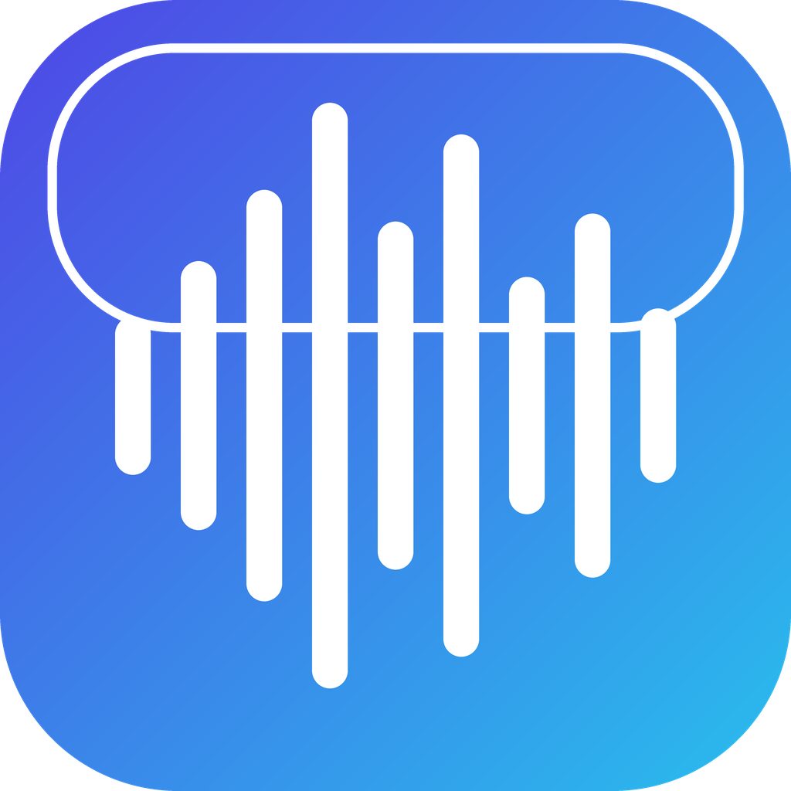

# 声纹工坊 · Voiceprint Studio

基于 [ERes2NetV2](https://www.modelscope.cn/models/zuosi041116/ERes2NetV2) 声纹模型的跨平台桌面应用，
支持 **声纹注册**、**声纹比对**、**1:N 声纹检索** 和 **音频波形展示**。
Windows / macOS / Linux 三平台通用，模型权重已随安装包内置，开箱即用、完全离线。



## 功能

| 页面 | 能力 |
| --- | --- |
| 声纹注册 | 麦克风录制或导入音频（WAV/FLAC/OGG/MP3/M4A/AAC/WMA…），实时波形与录音电平，填写姓名与备注后入库 |
| 声纹比对 | 任意两段音频（或声纹库中的样本）两两比对，余弦相似度仪表盘 + 判定结论（阈值默认 0.365，可调） |
| 声纹检索 | 用一段音频在声纹库中做 1:N 检索，按相似度排序返回最可能的说话人 |
| 声纹库 | 按说话人管理样本：试听、删除、查看样本时长/采集时间、打开音频所在目录 |

- 192 维声纹嵌入，16 kHz 单声道，80 维 Kaldi fbank + 逐句均值归一化，与 ModelScope 官方推理流程一致。
- 所有数据保存在本机：SQLite 数据库 + 原始音频副本，音频以 16-bit PCM WAV 归档。
- 界面为 Qt6（PySide6）深色侧边栏 + 浅色工作区，含自绘波形控件与相似度仪表盘。

## 下载与安装

构建产物位于各平台的 `dist/` 目录：

| 平台 | 产物 | 安装方式 |
| --- | --- | --- |
| macOS (Apple Silicon / Intel) | `VoiceprintStudio-1.0.0-{arm64,x86_64}.dmg` | 打开 DMG，将「Voiceprint Studio」拖入「应用程序」 |
| Windows 10/11 x64 | `VoiceprintStudio-1.0.0-Setup.exe` | 双击安装（默认按用户安装，无需管理员权限） |
| Debian / Ubuntu | `VoiceprintStudio-1.0.0-amd64.deb` | `sudo apt install ./VoiceprintStudio-1.0.0-amd64.deb` |
| 通用 Linux | `VoiceprintStudio-1.0.0-x86_64.AppImage` | `chmod +x` 后直接运行 |

> 安装包未做代码签名/公证。macOS 首次打开如提示「无法验证开发者」，可执行
> `xattr -dr com.apple.quarantine "/Applications/Voiceprint Studio.app"`，
> 或右键 →「打开」。Windows SmartScreen 提示时选择「更多信息 → 仍要运行」。
>
> macOS 首次录音时系统会请求麦克风权限，请在「系统设置 → 隐私与安全性 → 麦克风」中允许。

Linux 运行依赖（Deb 包已声明，AppImage 需系统自带）：

```bash
sudo apt install libportaudio2 libgl1 libegl1 libxkbcommon-x11-0 libxcb-cursor0 \
  libxcb-icccm4 libxcb-keysyms1 libxcb-randr0 libxcb-shape0 libxcb-xkb1
```

## 数据存储位置

| 平台 | 路径 |
| --- | --- |
| macOS | `~/Library/Application Support/VoiceprintStudio/` |
| Windows | `%APPDATA%\VoiceprintStudio\` |
| Linux | `~/.local/share/voiceprint-studio/`（或 `$XDG_DATA_HOME`） |

目录内包含 `voiceprints.db`（SQLite）与 `audio/`（音频副本）。可在启动前用环境变量
`VOICEPRINT_STUDIO_HOME=/path/to/dir` 重定向。卸载应用不会删除这些数据。

## 从源码运行

需要 Python 3.10+（推荐 3.12）：

```bash
python -m venv .venv && source .venv/bin/activate   # Windows: .venv\Scripts\activate
# Windows / Linux：先装 CPU 版 PyTorch，避免拉取数 GB 的 CUDA 依赖
pip install torch torchaudio --index-url https://download.pytorch.org/whl/cpu
pip install -r requirements.txt
python scripts/download_model.py                     # 若 resources 中尚无 checkpoint
python main.py
```

macOS / Linux 也可用项目内置的 uv 环境：

```bash
uv venv --python 3.12 && uv pip install -r requirements.txt
uv run python main.py
```

自检（无界面，验证模型、libsndfile 与 FFmpeg 解码链路）：

```bash
python main.py --self-test
# 打包后：
"dist/Voiceprint Studio.app/Contents/MacOS/VoiceprintStudio" --self-test
```

## 打包安装包

PyInstaller 配置见 `packaging/voiceprint_studio.spec`，资源（模型权重、图标、
PortAudio、libsndfile、FFmpeg）会被打进 one-dir 产物。

```bash
pip install -r requirements-dev.txt
python scripts/make_icons.py        # 重新生成 icon.png / icon.ico / icon.icns

# macOS：.app + DMG（可选 Apple 公证，设置 APPLE_ID/APPLE_TEAM_ID/APPLE_APP_PASSWORD）
packaging/macos/build_dmg.sh

# Windows：需安装 Inno Setup 6，生成 Setup.exe
powershell -ExecutionPolicy Bypass -File packaging\windows\build.ps1

# Linux：.deb + AppImage（需要 dpkg-deb；AppImage 工具会自动下载）
packaging/linux/build_packages.sh
```

> Windows / Linux 打包前请安装 **CPU 版 PyTorch**，否则安装包会额外携带 CUDA 运行库：
> `pip install torch torchaudio --index-url https://download.pytorch.org/whl/cpu`

三平台产物可由 GitHub Actions 构建（`.github/workflows/build.yml`）：
推送 `v*` 标签或手动触发 `workflow_dispatch`，矩阵覆盖 macOS arm64 / Intel、
Windows x64、Linux x64，产物在 Artifacts 中。

## 技术实现

```
src/voiceprint_studio/
├── app.py                 # QApplication 启动、--self-test/--version
├── engine.py              # ERes2NetV2 加载、fbank 特征、192 维嵌入、相似度
├── models/eres2netv2.py   # ERes2NetV2 网络结构（AFF / TSTP 池化 / 自底向上融合）
├── audio.py               # 解码（libsndfile→FFmpeg 回退）、录音、播放、波形峰值
├── store.py               # SQLite 声纹库（WAL），嵌入以 float32 BLOB 存储
├── context.py             # 应用上下文（引擎 + 数据库 + 后台任务）
├── selftest.py            # 无头自检，用于校验打包产物
└── ui/                    # Qt 界面：主题、自绘控件、后台 Worker、四个页面
resources/
├── pretrained_eres2netv2.ckpt   # 68 MB，随安装包分发
└── configuration.json
```

- 推理使用 CPU（Apple Silicon 上 PyTorch 自动使用加速后端），单段音频嵌入通常 < 1 秒。
- 相似度判定：余弦相似度 ≥ 阈值视为同一说话人；ERes2NetV2 官方推荐阈值 `0.365`。
- 支持的音频格式由 libsndfile 与内置 FFmpeg 共同覆盖，无需用户另行安装 FFmpeg。

## 致谢与许可

- 声纹模型：[zuosi041116/ERes2NetV2](https://www.modelscope.cn/models/zuosi041116/ERes2NetV2)（Apache-2.0）
- 推理框架：PyTorch / TorchAudio；界面：Qt for Python（PySide6，LGPL-3.0）
- 本项目以 Apache-2.0 发布，第三方组件许可见 [LICENSE.txt](LICENSE.txt)。